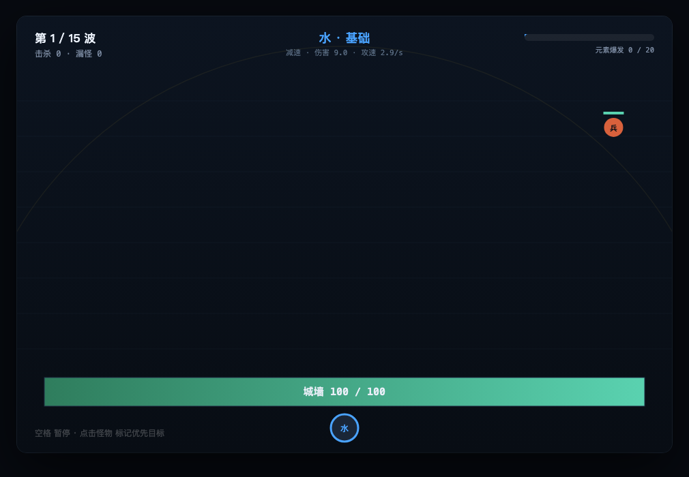

# 守城 · 沙盒 v0.3（实验）

单文件：`sandbox.html`。**双击就能玩，不需要 Node / 服务器 / 构建。**
`node .../test/sandbox.mjs` 只是自动化验证，不玩也可以。v0.2 的三路版本保留在 `index.html` 做对比。


## 这版在试什么

- **无路**：怪在 `x ∈ [70, 890]` 随机位置从天而降，直线走向城墙；炮台固定底部中央，圆形射程，**不转向**
- **自动攻击**：默认打最靠近城墙的怪；**点击怪物**可标记优先目标（暂停时点也行）
- **15 波**：城墙贯穿整局，不自动回血；15 波内墙不塌就赢
- **3 幕**：
  - 1–5 波：单元素（本系）
  - 6–10 波：双元素（一级形态）
  - 11–15 波：三元素（二级/三级形态），第 15 波 Boss
- **两次加元素**：第 5、10 波结束各熔入一个元素，形态永久进化
- **六次强化**：第 2/4/7/9/12/14 波结束三选一（攻速/伤害/射程/范围/穿透/链/减速/持续/击退/易伤/充能/修墙）
- **元素爆发**：普攻攒 20 次自动触发一次，形态决定效果（新星/浪潮/旋涡/地震）
- **没有技能**：技能放哪、放什么，等这版试完再定

## 操作

| 操作 | 作用 |
|---|---|
| 自动 | 普攻、索敌 |
| 点击怪 | 标记优先目标（再点空地取消） |
| 空格 | 暂停 |
| 波间 | 点卡片选强化/元素 |

## 调试参数

```
?autostart=1&element=fire                  # 直接开局
?autostart=1&element=fire&wave=11&form=magstorm   # 跳到第 11 波，磁暴形态
?wall=50&seed=3                            # 改城墙 / 换随机种子
```

## 自动化验证（不是玩）

```bash
node castle-guard/test/sandbox.mjs
```

跑 4 个起始元素 × 3 个种子，自动选卡，检查 15 波流程、两次进化、六次强化、城墙胜负。
当前结果：**9/12 胜**（智能选卡），输的 3 局都在第 10 波前后。

## 已知边界

- **第三元素暂时允许一级元素**（会跳到三级），因为树里「冰」「爆」没有二级配方；
  正式版由法师等级限制低级局只能用基础系
- 数值全部是占位，没做平衡器
- 没有技能、没有金币/商店、没接炼金台
- 城墙没有自动回血，只能靠「修补」卡
- 元素和技能的关系还没接（技能下一版）




