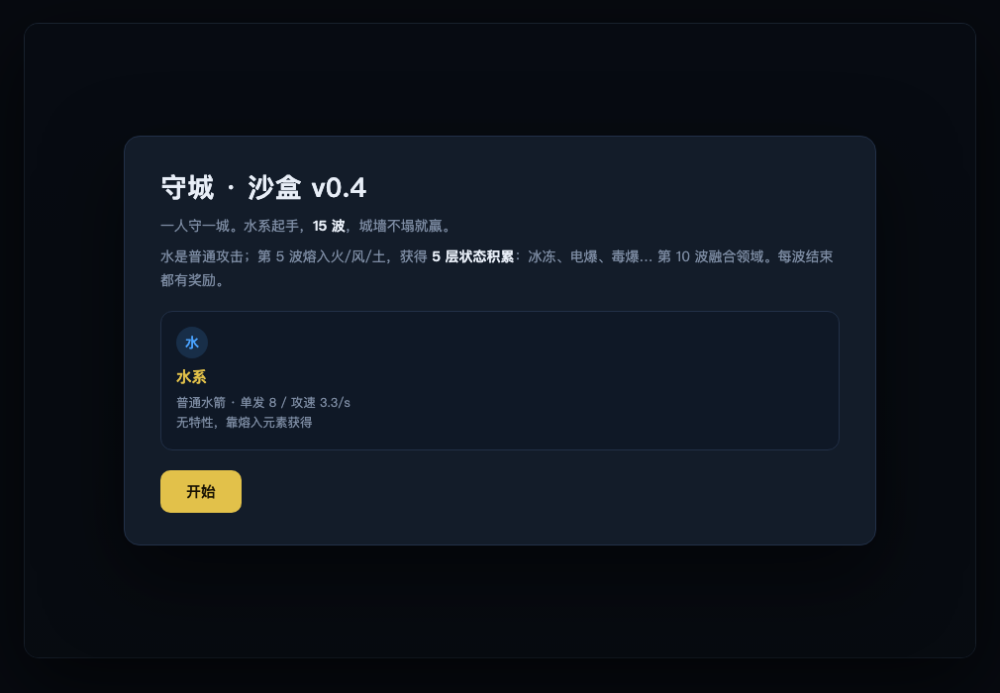
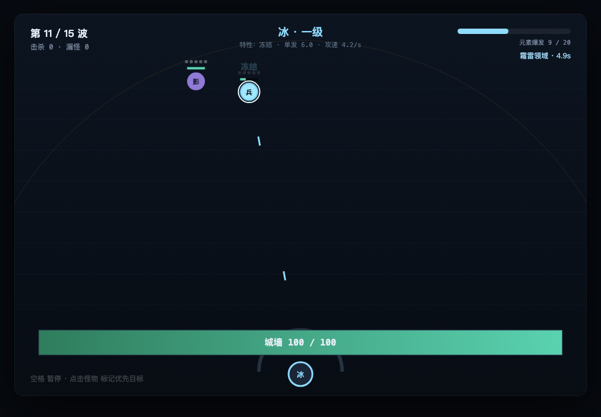
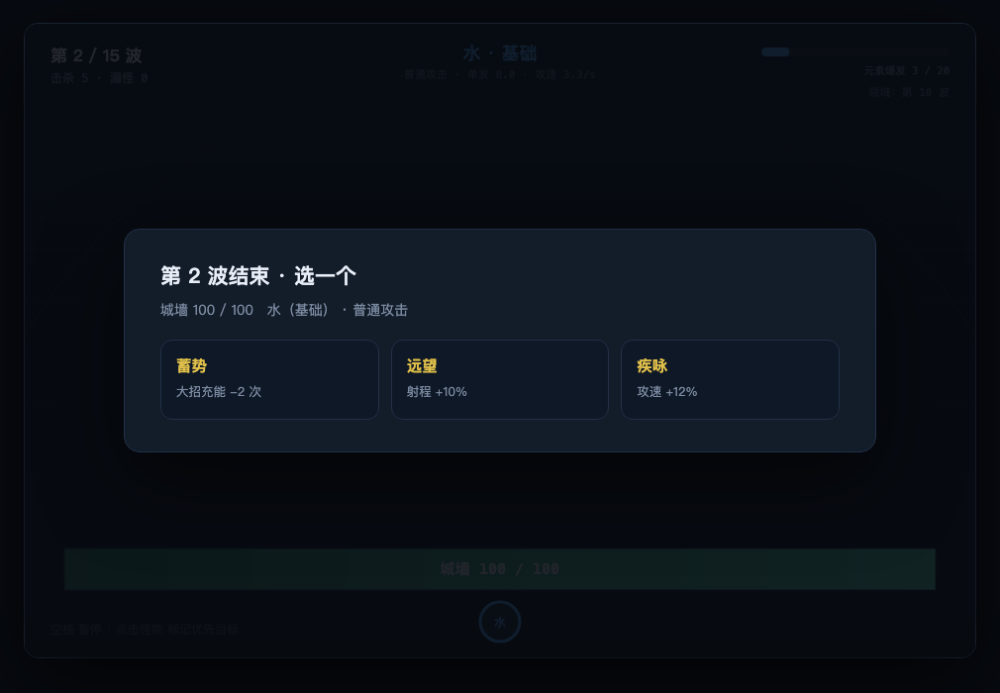
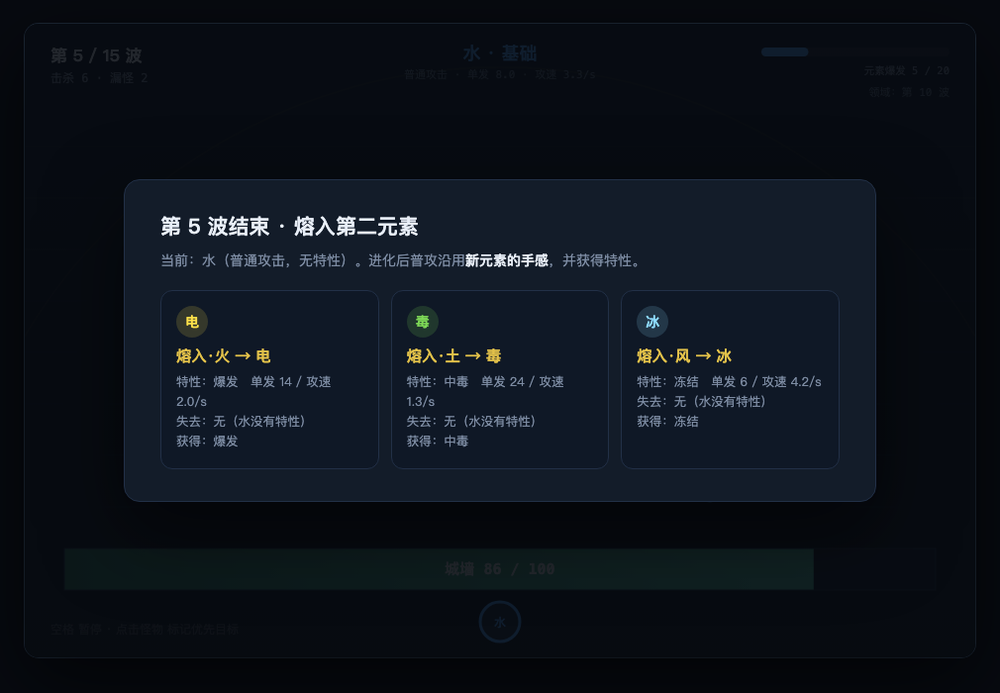
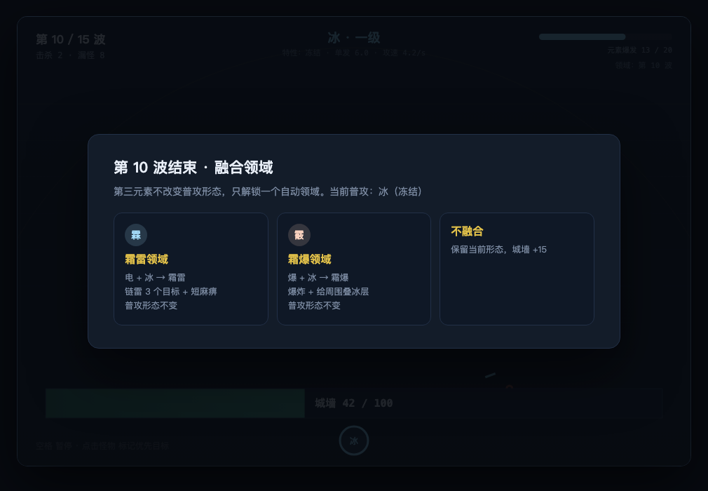

# 守城 · 沙盒 v0.4（实验）

单文件：`sandbox.html`。**双击就能玩，不需要 Node / 服务器 / 构建。**
`node .../test/sandbox.mjs` 只是自动化验证，不玩也可以。



## 这版在试什么

- **水系单一起手**：变量少一点
- **15 波，每波结束都有奖励**：
  - 第 1–4 波：水系基础强化（伤害/攻速/射程/充能/修墙）
  - **第 5 波：熔入第二元素**（火→电 / 风→冰 / 土→毒）
  - 第 6–9 波：当前特性强化（印记、proc、持续、每击效果）
  - **第 10 波：融合领域**（第三元素，普攻形态不变）
  - 第 11–14 波：领域强化
  - 第 15 波：Boss，城墙不塌就赢
- **5 层状态积累**：每次命中 +1，3 秒不挨打开始衰减；满 5 层触发
  - 冰：冻结；电：爆发伤害；毒：毒爆；爆：爆炸；金属：破甲；沙：击退
- **基础四系没有特性**，只有手感差异（水快、火中、风最快、土最重）；
  混合形态沿用**后加元素**的手感 + 自己的特性
- **不继承**：进化时清空特性加成（连锁/穿透/范围/减速/毒/击退/破甲），
  只保留通用属性（伤害/攻速/射程/充能）
- **没有 +25% 自动增伤**：最后 5 关的强度来自 proc、领域和强化



## 领域（第三元素）

普攻形态不变，第三元素只解锁一个自动领域：

| 领域 | 来源 | 效果 |
|---|---|---|
| 霜雷领域 | 冰 + 电 | 链雷 3 个目标 + 短麻痹 |
| 霜爆领域 | 冰 + 爆 | 爆炸 + 给周围叠冰层 |
| 磁暴领域 | 电 + 金属 | 把怪拉向中心 + 伤害 |
| 蚀钢领域 | 毒 + 金属 | 全场中毒 + 破甲 |
| 烟幕领域 | 毒 + 火 | 全场减速 + 持续伤害 |

HUD 右上角有领域倒计时；第 10 波从当前形态可融合的领域里选。

## 操作

| 操作 | 作用 |
|---|---|
| 自动 | 普攻、索敌 |
| 点击怪 | 标记优先目标（再点空地取消） |
| 空格 | 暂停 |
| 波间 | 点卡片选奖励 |

## 调试参数

```
?autostart=1&element=water
?autostart=1&element=water&wave=11&form=ice&profile=wind&domain=frost
?wall=50&seed=3
```

## 自动化验证

```bash
node castle-guard/test/sandbox.mjs
```

水系起手，3 个种子跑满 15 波、14 次奖励；会检查第 5 波进化成冰、第 10 波拿到霜雷领域。
当前：**3/3 胜，剩余城墙 70–100**（占位数值，还没调平衡）。






## 已知边界

- 只有水系起手；其他系只能用调试参数开
- 平衡是占位；模拟只跑了水→冰这条线，电/毒线可玩但未单独验证；其他起始系只能调试
- 水→冰/电/毒之外的元素组合，领域效果会走通用 fallback
- 没有技能、金币/商店、没接炼金台
- 城墙只靠「修补」卡回血
- 第 10 波领域是自动周期触发，玩家不手动开
